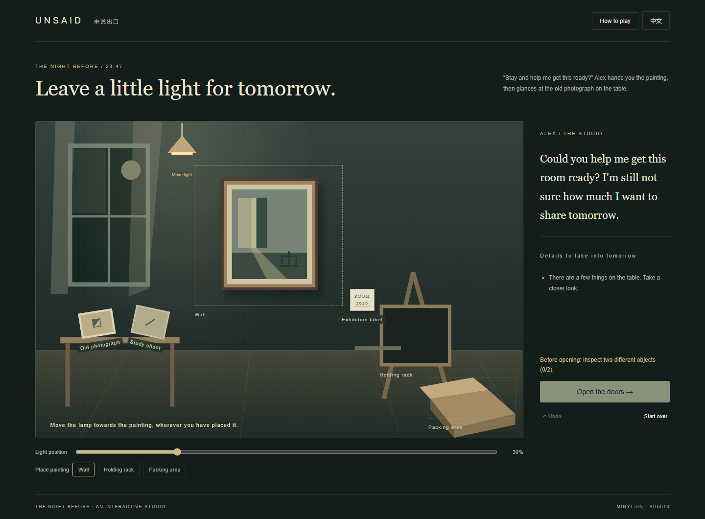

# Unsaid / 未说出口

SD5913 Assignment 3 · Individual interactive experience

[Play Unsaid / 在线试玩](https://iceyhikari.github.io/unsaid/)

## Status / 当前状态

Playable first prototype, 20 October 2026. All 12 conversation routes reach four endings. Author review and the required real-person trial remain pending.

2026 年 10 月 20 日：首个可玩原型，12 条对话路线通向四个结尾。仍待作者审阅与必需的真人试用。



## Starting idea / 初步构想

A short narrative experience for people interested in how we listen and respond to others. The player chooses a reply in one fictional conversation; the character's response and the next available choices change. The intention is to explore emotional expression through a small, understandable interaction. This is a proposed direction awaiting the author's review, not a final design.

面向关注人与人沟通的玩家，以一段虚构对话探索倾听与回应。玩家选择一句回应，角色的反馈和后续选项随之变化。通过一个清楚的小交互表达情感。此方向待作者审阅，尚未定稿。

## Planned interaction / 计划交互

- Input: choose a response. / 输入：选择回应。
- Response: update the conversation state and character dialogue. / 响应：更新对话状态与角色台词。
- Feedback: show the chosen reply, the character's reaction and available next actions. / 反馈：呈现已选回应、角色反应和下一步操作。
- Recovery: support restarting; handle repeated activation without skipping dialogue. / 恢复：支持重新开始，避免重复点击跳过对话。

## Running / 运行

Install Python 3 if needed. From a fresh terminal, enter the repository folder and run:

```powershell
git clone https://github.com/IceyHikari/unsaid.git
cd unsaid
py -m http.server 8033 --bind 127.0.0.1
```

Open http://127.0.0.1:8033 in a browser. On macOS/Linux use `python3` instead of `py`. Stop the server with Ctrl+C. If port 8033 is occupied, use 8034 and open that port instead. No packages, build, account or API key are needed for the experience. Choose a reply with a mouse or Tab then Enter. Use 中文 / English to switch language without losing your place; Go back undoes one reply; Start again resets the conversation.

在仓库目录运行上述命令，浏览器打开对应地址。无需安装第三方依赖。点击回应推进对话，支持键盘 Tab / Enter、中英文切换、回退和重启。Ctrl+C 停止服务器。

## Implementation and limitations / 实现与局限

`story.js` defines bilingual dialogue states and explicit choice targets. In `app.js`, `choose()` records the previous state, selects the target state and calls `render()` to show the character response and next choices. A 350 ms guard prevents rapid double activation from skipping a turn. Back restores the recorded state; reset clears the path. Only the most recent reply is shown during play; the ending includes a full choice recap.

The intended user is someone interested in short reflective fiction about listening. The fictional scene concerns bereavement and artistic privacy. It is not counselling or an assessment of empathy. Choices are authored branches, not generated dialogue; paths deliberately converge. Refreshing closes the current playthrough and returns to the beginning. There is no save system, audio or remote service. The illustration is CSS, and the empty frame is a visual metaphor rather than a reproduction of Alex's painting. AI-assisted dialogue remains subject to the author's editorial review.

作品面向喜欢短篇反思性叙事的玩家，涉及丧亲记忆与艺术表达的边界。对白为预写分支，部分路线会汇合；刷新后从头开始，没有存档或音频。它不评估玩家的同理心。左侧空画框是视觉隐喻。AI 协助编写的对白仍待作者审阅。

Development checks: `node verify.cjs` checks every route. Optional browser QA uses `npm install --no-save --package-lock=false playwright`, installed Microsoft Edge, the server above and `node browser-check.cjs`. Node and Playwright are development tools only.

## Submission plan / 提交计划

Due 1 November 2026, 23:59 Hong Kong time, according to the Canvas brief supplied by the author. Submit this public repository URL through Canvas when ready.

- [ ] Confirm intended user, scene and interaction.
- [x] Implement and verify the main interaction and recovery behavior.
- [x] Add a screenshot and exact run instructions.
- [ ] Observe at least one other person trying it before explaining the controls.
- [ ] Record the observation and resulting decision in PROCESS.md.
- [ ] Complete credits, limitations and fresh-terminal verification.
- [ ] Verify signed-out repository access and submit the URL on Canvas.

以上为待完成事项，不表示已完成试用或提交。

See [PROCESS.md](PROCESS.md) for development decisions and [CREDITS.md](CREDITS.md) for attribution.
